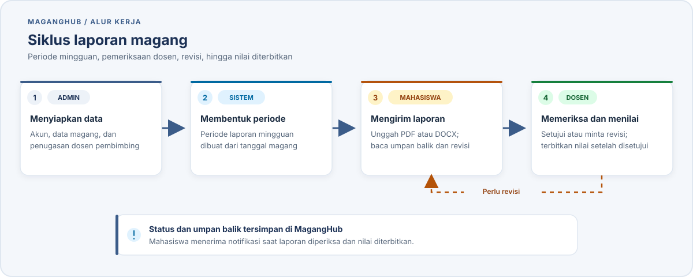
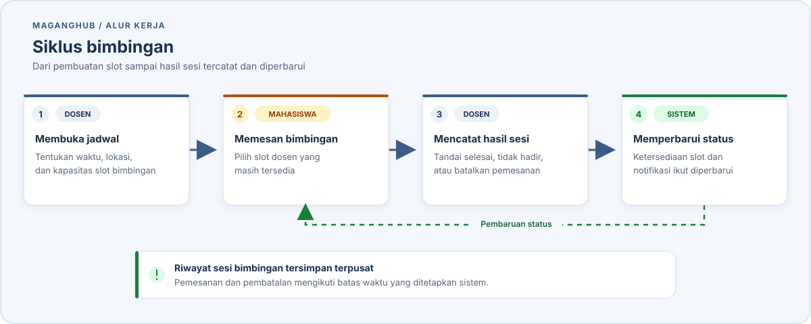

<p align="center">
  
</p>

<h1 align="center">MagangHub</h1>

<p align="center">
  Sistem informasi untuk mengelola kegiatan magang, laporan mingguan, bimbingan, dan penilaian mahasiswa.
</p>

## Daftar Isi

- [Tentang MagangHub](#tentang-maganghub)
- [Peran Pengguna](#peran-pengguna)
- [Fitur Inti](#fitur-inti)
- [Alur Kerja Utama](#alur-kerja-utama)
- [Teknologi](#teknologi)
- [Persyaratan](#persyaratan)
- [Menjalankan Secara Lokal](#menjalankan-secara-lokal)
- [Panel dan Halaman](#panel-dan-halaman)
- [Perintah Pengembangan](#perintah-pengembangan)

## Tentang MagangHub

MagangHub membantu perguruan tinggi menjalankan proses magang dalam satu sistem. Admin mengelola akun dan data akademik, mahasiswa mengirim laporan serta mengatur bimbingan, sedangkan dosen membimbing mahasiswa, memeriksa laporan, dan menerbitkan nilai.

## Peran Pengguna

| Peran | Tanggung jawab utama | Area aplikasi |
| --- | --- | --- |
| Admin | Mengelola akun, data magang, periode laporan, penugasan pembimbing, rekap, dan pemantauan proses. | Panel Filament `/admin` |
| Dosen | Membuat slot bimbingan, mengelola pemesanan, memeriksa laporan, meminta revisi atau menyetujui laporan, serta menerbitkan nilai. | Panel Filament `/dosen` |
| Mahasiswa | Melihat progres magang, mengirim dan memperbaiki laporan mingguan, melihat nilai, serta memesan bimbingan. | Panel mahasiswa berbasis Livewire |

Akun pengguna dikelola oleh admin. Mahasiswa dan dosen masuk melalui halaman login sesuai perannya.

## Fitur Inti

- Pengelolaan akun pengguna, data magang, periode laporan, dan penugasan pembimbing.
- Pembuatan periode laporan mingguan otomatis berdasarkan tanggal magang.
- Pengiriman laporan dalam format PDF atau DOCX, termasuk pembacaan PDF di browser.
- Pemeriksaan laporan dengan alur persetujuan atau permintaan revisi.
- Pencatatan dan penerbitan nilai laporan.
- Pengelolaan slot dan pemesanan bimbingan, termasuk pencatatan kehadiran dan hasil sesi.
- Notifikasi alur kerja untuk pembaruan laporan, bimbingan, dan nilai.
- Pengaturan profil, keamanan akun, dan tampilan sesuai area pengguna.

## Alur Kerja Utama

### Siklus magang dan laporan



Periode laporan dibuat otomatis ketika data magang dibuat. Laporan yang terlambat tetap dapat dikirim dan ditandai sebagai terlambat. Persetujuan laporan mengunci versi yang disetujui; nilai yang sudah diterbitkan bersifat final.

### Siklus bimbingan



## Teknologi

- Laravel 13 dan PHP 8.3 atau lebih baru
- Filament 5 untuk panel admin dan dosen
- Livewire 4 untuk panel mahasiswa dan interaksi dinamis
- Tailwind CSS 4 dan Vite untuk aset antarmuka
- MySQL sebagai konfigurasi basis data bawaan

## Persyaratan

- PHP 8.3+ dengan ekstensi yang dibutuhkan Laravel
- Composer
- Node.js dan npm
- MySQL atau layanan basis data lain yang didukung Laravel

## Menjalankan Secara Lokal

1. Pasang dependensi PHP:

   ```bash
   composer install
   ```

2. Siapkan file konfigurasi lokal. Di Windows PowerShell:

   ```powershell
   Copy-Item .env.example .env
   ```

   Di macOS atau Linux:

   ```bash
   cp .env.example .env
   ```

3. Buat basis data kosong, lalu sesuaikan `DB_DATABASE`, `DB_USERNAME`, dan `DB_PASSWORD` di `.env`.

4. Isi konfigurasi akun admin pertama di `.env`:

   ```dotenv
   MAGANG_ADMIN_NAME="Administrator MagangHub"
   MAGANG_ADMIN_EMAIL="admin@example.test"
   MAGANG_ADMIN_PASSWORD="GantiDenganKataSandiKuat"
   ```

5. Buat application key, jalankan migrasi dan seeder:

   ```bash
   php artisan key:generate
   php artisan migrate
   php artisan db:seed
   ```

   Seeder membuat akun admin pertama jika tiga variabel `MAGANG_ADMIN_*` telah diisi. Pada lingkungan `local` dan `testing`, seeder juga menyiapkan data demo.

6. Pasang dependensi frontend dan jalankan Vite:

   ```bash
   npm install
   npm run dev
   ```

7. Di terminal lain, jalankan aplikasi:

   ```bash
   php artisan serve
   ```

Buka alamat yang ditampilkan oleh `artisan serve`. Untuk menghentikan proses development, hentikan kedua proses terminal tersebut.

## Panel dan Halaman

| Halaman | Path | Pengguna |
| --- | --- | --- |
| Landing page | `/` | Publik |
| Login mahasiswa | `/login` | Mahasiswa |
| Login admin | `/admin/login` | Admin |
| Panel admin | `/admin` | Admin |
| Login dosen | `/dosen/login` | Dosen |
| Panel dosen | `/dosen` | Dosen |
| Dashboard mahasiswa | `/mahasiswa` | Mahasiswa |
| Laporan mingguan | `/mahasiswa/laporan` | Mahasiswa |
| Bimbingan mahasiswa | `/bimbingan` | Mahasiswa |

Panel admin dan dosen menyediakan halaman profil serta pengaturan melalui menu akun. Hak akses data dan tindakan dibatasi berdasarkan peran dan penugasan pembimbing.

## Perintah Pengembangan

```bash
# Menjalankan proses development yang dikonfigurasi proyek
composer run dev

# Membuat aset frontend untuk deployment
npm run build

# Memformat kode PHP
composer run lint

# Menjalankan tes aplikasi
php artisan test
```
